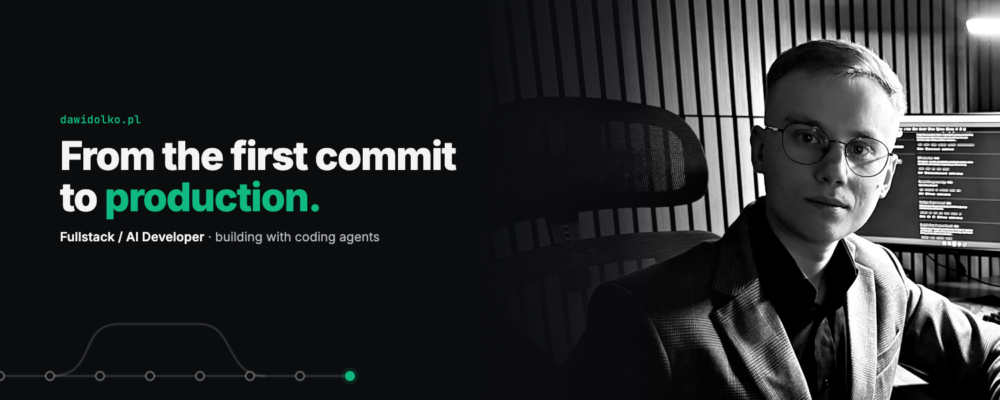
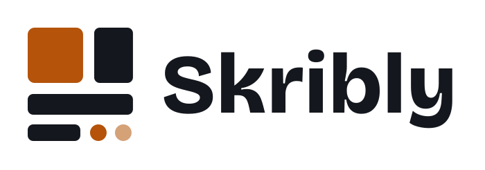
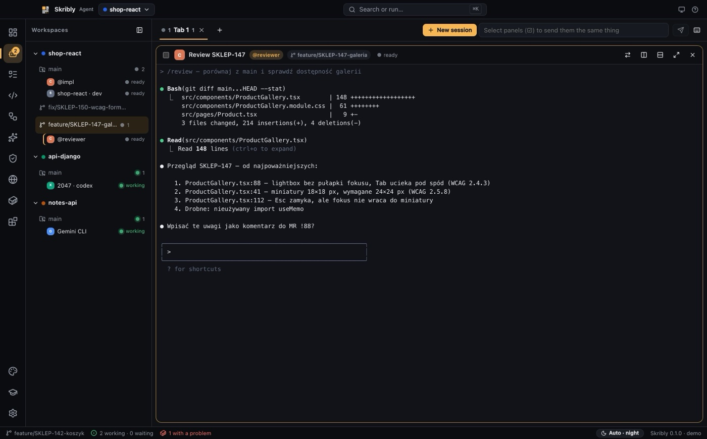
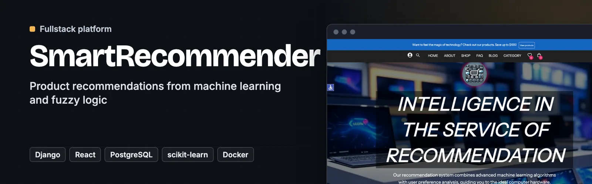

  

  

  <b>I build web applications end to end, and tools for working with AI coding agents.</b> 
  Rzeszów, Poland · BEng Computer Science · MSc in progress

  
  
  
  
  

  

---

## 👋 About me

I am a fullstack / AI developer from Rzeszów, Poland. I completed a **BEng in Computer Science** at the University of Rzeszów (2022–2026) and I am now working towards an **MSc** there. Since 2025 I have been building web applications at **Ideo Software**, and after hours I ship my own products — e-commerce storefronts, a banking platform on a real double-entry ledger, ticketing systems and machine learning classifiers.

Three things I care about in every project: functionality that actually works instead of a demo, documentation someone else can follow, and a deployment that keeps running once I walk away.

- 🔭 **Now building** [Skribly](https://skribly.pl) with [Piotr Smoła](https://github.com/PiotrSmola), [Michał Pilecki](https://github.com/Prawy126), [Konrad Pluta](https://github.com/g00staw) and [Mateusz Olko](https://github.com/OlkoMateusz)
- 🏢 **Frontend Web Developer @ Ideo Software** — Laravel · PHP · React · MySQL
- 🎓 **MSc Computer Science** in progress · **BEng Computer Science** completed — University of Rzeszów
- 🧰 Comfortable across **four backend stacks** — Laravel, Django, ASP.NET Core and Nuxt/Node
- ♿ Every recent project ships with **accessibility work and bilingual (PL/EN) content**
- 🎬 Video creator on YouTube since 2023 — recording, editing and publishing my own channel
- 📫 Reach me at **contact@dawidolko.pl**

---

## ✒️ Skribly — my own ecosystem

  

<em>Ink and rubric — tools for planning work and building software with AI agents, designed as one family.</em>

**Skribly** is a private project I build with four friends, **[Piotr Smoła](https://github.com/PiotrSmola)**, **[Michał Pilecki](https://github.com/Prawy126)**, **[Konrad Pluta](https://github.com/g00staw)** and **[Mateusz Olko](https://github.com/OlkoMateusz)**, independent of my employment. It is a family of developer tools for people who write software with AI coding agents. It is non-commercial: nothing is sold, it has no clients and offers no services, and its repositories stay private while we build. Three apps do the work and three shared pieces stand behind them.

<table>
  <tr>
    <td width="33%" valign="top" align="center">
       
      <h3>Skribly Tracker</h3>
      
The issue tracker of the family: projects, issues with keys such as <code>SKR-12</code>, Kanban boards, comments and subtasks, in the browser and inside Skribly Agent, with a REST API described in OpenAPI. It is the default tracker in Skribly Agent and one of six trackers the agent-skills <code>task</code> skill supports.

      
      
    </td>
    <td width="33%" valign="top" align="center">
       
      <h3>Skribly Agent</h3>
      
A desktop app that runs AI coding agents side by side (Claude Code, Codex, Cursor Agent, Gemini CLI and more) and shows which one works, waits or has finished, with tracker tasks, a git worktree per agent, pipelines, review notes and audits. In development.

      
      
    </td>
    <td width="33%" valign="top" align="center">
       
      <h3>agent-skills</h3>
      
36 portable skills — task workflow, commits, reviews, tests, PageSpeed, security and WCAG audits, migrations, Docker, CI — that adapt to each project through a project profile and confirmed lessons, with one installer for seven coding agents.

      
      
    </td>
  </tr>
  <tr>
    <td width="33%" valign="top" align="center">
       
      <h3>Skribly Core</h3>
      
The shared contracts in TypeScript: the Tracker API schemas and client, webhook signing and verification, identity and scopes, a catalogue of CloudEvents events and an app registry. In development.

      
      
    </td>
    <td width="33%" valign="top" align="center">
       
      <h3>Skribly UI</h3>
      
The design system of the family: design tokens, plain CSS classes for any page, React components on React Aria and the Astro site kit of the three Skribly sites, with light, dark and high-contrast themes. Built to WCAG 2.2 AA as a target. See it at <a href="https://ui.skribly.pl">ui.skribly.pl</a>.

      
      
    </td>
    <td width="33%" valign="top" align="center">
       
      <h3>Skribly Docs</h3>
      
The documentation in English and Polish: installing and using Skribly Agent, agent-skills and Skribly Tracker, the Tracker REST API reference, and the Core and UI packages. Read it at <a href="https://docs.skribly.pl">docs.skribly.pl</a>.

      
      
    </td>
  </tr>
</table>

  

> 🌐 Website: **[skribly.pl](https://skribly.pl)** · Documentation: **[docs.skribly.pl](https://docs.skribly.pl)** · Design system: **[ui.skribly.pl](https://ui.skribly.pl)**
>
> 🔒 Skribly is private and non-commercial: its repositories stay in the **private skribly organisation on GitHub** while we build, and only the three sites above are public, in English and Polish. Authors: **Dawid Olko**, **[Piotr Smoła](https://github.com/PiotrSmola)**, **[Michał Pilecki](https://github.com/Prawy126)**, **[Konrad Pluta](https://github.com/g00staw)** and **[Mateusz Olko](https://github.com/OlkoMateusz)**.

<b>See Skribly Agent in action</b>

 

  

  
  
  

---

## 📄 CV

My CV lives as a page, in Polish and English, and prints to a single A4 sheet:
**[cv.dawidolko.pl](https://cv.dawidolko.pl)** · [English version](https://cv.dawidolko.pl/en/)

---

## 🚀 Selected Work

<table>
  <tr>
    <td width="50%"> <a href="https://cvforge.dawidolko.pl">Live site</a> · <a href="https://github.com/dawidolko/CVForge-Platform">Code</a> · <a href="https://dawidolko.pl/projects/cvforge/" title="CVForge, Aug 2026 – Sep 2026. The preview is the print. Shows: The preview is the printed sheet, Open the finished CV in its own tab, Import an existing CV from a PDF.">ⓘ Details</a></td>
    <td width="50%"> <a href="https://neobank.dawidolko.pl">Live site</a> · <a href="https://github.com/dawidolko/NeoBank-Platform-Nuxt">Code</a> · <a href="https://dawidolko.pl/projects/neobank/" title="NeoBank, Jul 2026 – Aug 2026. Fullstack Retail Banking Platform. Shows: Multi-Currency Accounts, Double-Entry Ledger, Instant Internal Transfers.">ⓘ Details</a></td>
  </tr>
  <tr>
    <td width="50%"> <a href="https://reelcut.dawidolko.pl">Live site</a> · <a href="https://github.com/dawidolko/ReelCut-Platform">Code</a> · <a href="https://dawidolko.pl/projects/reelcut/" title="ReelCut, Aug 2026 – Sep 2026. The footage never leaves the tab. Shows: Several clips on one timeline, Delete, not just disable, Nothing is uploaded.">ⓘ Details</a></td>
    <td width="50%"> <a href="https://project.dawidolko.pl">Live site</a> · <a href="https://github.com/dawidolko/SmartRecommender-Project-Django-React">Code</a> · <a href="https://dawidolko.pl/projects/smartrecommender/" title="SmartRecommender, Dec 2024 – Feb 2026. Full-Stack Product Recommendation Platform. Shows: Collaborative Filtering, Content-Based Filtering, Association Rules.">ⓘ Details</a></td>
  </tr>
  <tr>
    <td width="50%"> <a href="https://ezscout.dawidolko.pl">Live site</a> · <a href="https://github.com/dawidolko/EzScout-Platform-NextJS">Code</a> · <a href="https://dawidolko.pl/projects/ezscout/" title="EzScout, Jun 2026 – Jul 2026. A report that says whether he is worth buying. Shows: Four packages, A sample report card in the hero, Honest results section.">ⓘ Details</a></td>
    <td width="50%"> <a href="https://zbudujkompa.dawidolko.pl/pl/">Live site</a> · <a href="https://github.com/dawidolko/ZbudujKompa">Code</a> · <a href="https://dawidolko.pl/projects/zbudujkompa/" title="ZbudujKompa, Jul 2026 – present. Build your PC without guessing. Shows: Configurator, Components, Platforms.">ⓘ Details</a></td>
  </tr>
</table>

<b>All projects</b>

 

<!-- projects:start -->

### Web platforms

| Project | When | What it is | Stack | Links |
| --- | --- | --- | --- | --- |
| **BitRecruit** ⭐ 1 | Feb 2026 – Mar 2026 | IT Career Platform | Next.js, React, TypeScript, Mantine | [ⓘ Details](https://dawidolko.pl/projects/bitrecruit/ "BitRecruit, Feb 2026 – Mar 2026. IT Career Platform. Shows: Filter offers, Pagination, Sorting.") · [Code](https://github.com/dawidolko/BitRecruit-Platform-NextJS) · [Live](https://bitrecruit.dawidolko.pl) |
| **DevPulse** ⭐ 1 | Jan 2026 – Feb 2026 | Modern Developer Tech Blog with React & TypeScript | React, TypeScript, Ant Design, Styled Components | [ⓘ Details](https://dawidolko.pl/projects/devpulse/ "DevPulse, Jan 2026 – Feb 2026. Modern Developer Tech Blog with React & TypeScript. Shows: Blog Post Cards, Post Detail Pages, Category System.") · [Code](https://github.com/dawidolko/DevTechBlog-Platform-React) · [Live](https://devtechblog.dawidolko.pl) |
| **BodyKit** | Jun 2026 – Jul 2026 | A front-end shop for car body kits and styling parts | Next.js, React, TypeScript, Tailwind CSS | [ⓘ Details](https://dawidolko.pl/projects/bodykit/ "BodyKit, Jun 2026 – Jul 2026. A front-end shop for car body kits and styling parts. Shows: Bilingual, Full catalog, Cart & checkout.") · [Code](https://github.com/dawidolko/BodyKit-Shop-Frontend-NextJS) · [Live](https://bodykit.dawidolko.pl) |
| **CVForge** | Aug 2026 – Sep 2026 | The preview is the print | Next.js, React, TypeScript, Tailwind CSS | [ⓘ Details](https://dawidolko.pl/projects/cvforge/ "CVForge, Aug 2026 – Sep 2026. The preview is the print. Shows: The preview is the printed sheet, Open the finished CV in its own tab, Import an existing CV from a PDF.") · [Code](https://github.com/dawidolko/CVForge-Platform) · [Live](https://cvforge.dawidolko.pl) |
| **EzPace** | Jun 2026 – Jul 2026 | A plan counted back from the race date, not bolted onto it | Next.js, React, TypeScript, Tailwind CSS | [ⓘ Details](https://dawidolko.pl/projects/ezpace/ "EzPace, Jun 2026 – Jul 2026. A plan counted back from the race date, not bolted onto it. Shows: A pace calculator that is not a mock-up, Splits that include the leftover distance, Three plans, one price each.") · [Code](https://github.com/dawidolko/EzPace-Platform-NextJS) · [Live](https://ezpace.dawidolko.pl) |
| **EzScout** | Jun 2026 – Jul 2026 | A report that says whether he is worth buying | Next.js, React, TypeScript, Tailwind CSS | [ⓘ Details](https://dawidolko.pl/projects/ezscout/ "EzScout, Jun 2026 – Jul 2026. A report that says whether he is worth buying. Shows: Four packages, A sample report card in the hero, Honest results section.") · [Code](https://github.com/dawidolko/EzScout-Platform-NextJS) · [Live](https://ezscout.dawidolko.pl) |
| **ReelCut** | Aug 2026 – Sep 2026 | The footage never leaves the tab | Next.js, React, TypeScript, Tailwind CSS | [ⓘ Details](https://dawidolko.pl/projects/reelcut/ "ReelCut, Aug 2026 – Sep 2026. The footage never leaves the tab. Shows: Several clips on one timeline, Delete, not just disable, Nothing is uploaded.") · [Code](https://github.com/dawidolko/ReelCut-Platform) · [Live](https://reelcut.dawidolko.pl) |
| **ZbudujKompa** | Jul 2026 – present | Build your PC without guessing | Next.js, React, TypeScript, Tailwind CSS | [ⓘ Details](https://dawidolko.pl/projects/zbudujkompa/ "ZbudujKompa, Jul 2026 – present. Build your PC without guessing. Shows: Configurator, Components, Platforms.") · [Code](https://github.com/dawidolko/ZbudujKompa) · [Live](https://zbudujkompa.dawidolko.pl/pl) |

### Fullstack platforms

| Project | When | What it is | Stack | Links |
| --- | --- | --- | --- | --- |
| **TechByte** ⭐ 5 | Mar 2024 – May 2024 | Hardware shop with a cart and an admin panel | Laravel, PHP, MySQL | [ⓘ Details](https://dawidolko.pl/projects/techbyte/ "TechByte, Mar 2024 – May 2024. Hardware shop with a cart and an admin panel. Shows: Oracle as the primary database, Logic in PL/SQL where it belongs, Two guards, two areas.") · [Code](https://github.com/dawidolko/TechByte-Project-Laravel) · [Live](https://techbyte.dawidolko.pl) |
| **RentalVOD** ⭐ 4 | Apr 2024 – May 2024 | Film rental with a cart and a graphical interface | Laravel, PHP, MySQL | [ⓘ Details](https://dawidolko.pl/projects/rentalvod/ "RentalVOD, Apr 2024 – May 2024. Film rental with a cart and a graphical interface. Shows: An editable recommendation rule, Rentals, not purchases, Loyalty points and referral codes.") · [Code](https://github.com/dawidolko/RentalVOD-Project-Laravel) |
| **MovieVault** ⭐ 2 | Jan 2026 – Feb 2026 | Full-Stack Movie Review Platform | Java, Spring Boot, React, TypeScript | [ⓘ Details](https://dawidolko.pl/projects/movievault/ "MovieVault, Jan 2026 – Feb 2026. Full-Stack Movie Review Platform. Shows: Movie Catalogue, Filtering & Sorting, JWT Authentication.") · [Code](https://github.com/dawidolko/MovieVault-Project-SpringBoot-React) |
| **WordPress Cinema** ⭐ 2 | Since Feb 2025 | A cinema in two containers | WordPress, Docker, MySQL, WooCommerce | [ⓘ Details](https://dawidolko.pl/projects/wordpress-cinema/ "WordPress Cinema, Since Feb 2025. A cinema in two containers. Shows: One command from nothing to a running site, wp-content in git, core in the image, A custom theme.") · [Code](https://github.com/dawidolko/Wordpress-Cinema-Docker) |
| **SmartRecommender** ⭐ 2 | Dec 2024 – Feb 2026 | Product recommendations from machine learning and fuzzy logic | Django, React, PostgreSQL, scikit-learn | [ⓘ Details](https://dawidolko.pl/projects/smartrecommender/ "SmartRecommender, Dec 2024 – Feb 2026. Product recommendations from machine learning and fuzzy logic. Shows: Collaborative Filtering, Content-Based Filtering, Association Rules.") · [Code](https://github.com/dawidolko/SmartRecommender-Project-Django-React) · [Live](https://project.dawidolko.pl) |
| **Weather App** ⭐ 2 | Jan 2025 | Weather app on the OpenWeather API, built during an internship | Laravel, React | [ⓘ Details](https://dawidolko.pl/projects/weather-app/ "Weather App, Jan 2025. Weather app on the OpenWeather API, built during an internship. Shows: Readings are kept, not discarded, Your own list of cities, Search any city in the world.") · [Code](https://github.com/dawidolko/Weather-App-Laravel-React) |
| **NeoBank** ⭐ 1 | Jul 2026 – Aug 2026 | Fullstack Retail Banking Platform | Nuxt, TypeScript, Prisma, PostgreSQL | [ⓘ Details](https://dawidolko.pl/projects/neobank/ "NeoBank, Jul 2026 – Aug 2026. Fullstack Retail Banking Platform. Shows: Multi-Currency Accounts, Double-Entry Ledger, Instant Internal Transfers.") · [Code](https://github.com/dawidolko/NeoBank-Platform-Nuxt) · [Live](https://neobank.dawidolko.pl) |
| **CinemaReserve** ⭐ 1 | Jan 2026 – Feb 2026 | Full-Stack Cinema Seat Reservation Platform | Angular, TypeScript, Node.js, Sequelize | [ⓘ Details](https://dawidolko.pl/projects/cinemareserve/ "CinemaReserve, Jan 2026 – Feb 2026. Full-Stack Cinema Seat Reservation Platform. Shows: Home, Movie Detail, Seat Selection.") · [Code](https://github.com/dawidolko/CinemaReserve-Project-Node-Angular) |
| **IT Help Desk** ⭐ 1 | Oct 2025 – Nov 2025 | Modern IT Help Desk Ticketing System | Vue.js, ASP.NET Core, MySQL, TypeScript | [ⓘ Details](https://dawidolko.pl/projects/it-help-desk/ "IT Help Desk, Oct 2025 – Nov 2025. Modern IT Help Desk Ticketing System. Shows: Full CRUD Operations, Assignment System, Seven Ticket Statuses.") · [Code](https://github.com/dawidolko/ITHelpDeskSystem-Project-ASPNetCore-Vue) |
| **Language Courses** ⭐ 1 | May 2024 – Jun 2024 | Course catalogue with enrolment | Laravel, PHP | [ⓘ Details](https://dawidolko.pl/projects/language-courses/ "Language Courses, May 2024 – Jun 2024. Course catalogue with enrolment. Shows: A basket that produces enrolments, A date chosen at the point of buying, Roles enforced by middleware.") · [Code](https://github.com/dawidolko/LanguageCourses-Project-Laravel) |
| **Shop App** ⭐ 1 | Feb 2025 | Online store built during an internship | Laravel, Vue.js | [ⓘ Details](https://dawidolko.pl/projects/shop-app/ "Shop App, Feb 2025. Online store built during an internship. Shows: The basket is a table, not browser state, Checkout writes the paperwork, Browse by category or by brand.") · [Code](https://github.com/dawidolko/Shop-App-Laravel-Vue) |
| **Employee Directory** ⭐ 1 | Feb 2025 | Backend directory on MySQL, built during an internship | Laravel, MySQL | [ⓘ Details](https://dawidolko.pl/projects/employee-directory/ "Employee Directory, Feb 2025. Backend directory on MySQL, built during an internship. Shows: Filters that compose, Exports match the screen, One person, their whole history.") · [Code](https://github.com/dawidolko/Employees-List-Project-Laravel) |

### AI and machine learning

| Project | When | What it is | Stack | Links |
| --- | --- | --- | --- | --- |
| **Airline Passenger Satisfaction** ⭐ 2 | May 2026 – Jun 2026 | MLP classifier for passenger satisfaction | Python, scikit-learn | [ⓘ Details](https://dawidolko.pl/projects/airline-passenger-satisfaction/ "Airline Passenger Satisfaction, May 2026 – Jun 2026. MLP classifier for passenger satisfaction. Shows: MLP from scratch in PyTorch, 18-configuration grid search, Random Forest reference.") · [Code](https://github.com/dawidolko/Airline-Passenger-Classifier-Python-MLP-Classifier-Python) |
| **ANFIS vs classical ML** ⭐ 1 | Oct 2025 – Dec 2025 | ANFIS compared with classical models | Python, PyTorch | [ⓘ Details](https://dawidolko.pl/projects/anfis-vs-classical-machine-learning/ "ANFIS vs classical ML, Oct 2025 – Dec 2025. ANFIS compared with classical models. Shows: ANFIS implemented, not imported, Rules exported as JSON, Membership functions plotted.") · [Code](https://github.com/dawidolko/Comparison-ANFIS-Classical-Machine-Learning-Models-Python) |
| **DataFusion** ⭐ 1 | Mar 2025 – May 2025 | Data warehousing dashboard | Python, Streamlit | [ⓘ Details](https://dawidolko.pl/projects/datafusion/ "DataFusion, Mar 2025 – May 2025. Data warehousing dashboard. Shows: Undo is a first-class button, Descriptive statistics on demand, Both correlation matrices, side by side.") · [Code](https://github.com/dawidolko/DataFusion-App-Python) |
| **Cyber Attack Classifier** | Apr 2026 – Jun 2026 | Multiclass classification of network attacks | Python, scikit-learn | [ⓘ Details](https://dawidolko.pl/projects/cyber-security-attacks-classifier/ "Cyber Attack Classifier, Apr 2026 – Jun 2026. Multiclass classification of network attacks. Shows: Balanced three-class target, Automatic data acquisition, Full EDA suite.") · [Code](https://github.com/dawidolko/CyberAttack-Classifier-Python) |
| **Wine Quality** | Apr 2026 – May 2026 | Decision tree, kNN and random forest compared | Python, scikit-learn | [ⓘ Details](https://dawidolko.pl/projects/wine-quality-classification/ "Wine Quality, Apr 2026 – May 2026. Decision tree, kNN and random forest compared. Shows: Multiclass target, Nine classifier variants, Majority-voting ensemble.") · [Code](https://github.com/dawidolko/WineQuality-Classifier-Python) |

### Frontend

| Project | When | What it is | Stack | Links |
| --- | --- | --- | --- | --- |
| **FitnessGym** ⭐ 25 | Mar 2023 – Apr 2023 | A gym site with a shop attached | React, React Router, Sass, Framer Motion | [ⓘ Details](https://dawidolko.pl/projects/fitnessgym/ "FitnessGym, Mar 2023 – Apr 2023. A gym site with a shop attached. Shows: A cart that survives a refresh, Scroll as a narrative device, Page transitions, not page jumps.") · [Code](https://github.com/dawidolko/FitnessGym-Project-React) · [Live](https://fitnessgym.dawidolko.pl) |
| **Curiosities Magazine** ⭐ 11 | Nov 2023 – Dec 2023 | Responsive magazine in plain HTML and CSS | HTML5, CSS3 | [ⓘ Details](https://dawidolko.pl/projects/curiosities-magazine/ "Curiosities Magazine, Nov 2023 – Dec 2023. Responsive magazine in plain HTML and CSS. Shows: No behavioural JavaScript, Sixteen pages, one visual language, A full purchase path.") · [Code](https://github.com/dawidolko/CuriositiesMagazine-Project-HTML-CSS) · [Live](https://projekt1.dawidolko.pl) |
| **WidgetMart** ⭐ 8 | Jan 2024 – Feb 2024 | Responsive shop in plain HTML, CSS and JavaScript | HTML5, CSS3, JavaScript | [ⓘ Details](https://dawidolko.pl/projects/widgetmart/ "WidgetMart, Jan 2024 – Feb 2024. Responsive shop in plain HTML, CSS and JavaScript. Shows: A cart in localStorage, Live weather with a search history, A note manager as a real class.") · [Code](https://github.com/dawidolko/WidgetMart-Project-HTML-CSS-JS) · [Live](https://projekt2.dawidolko.pl) |
| **F1 Zone** ⭐ 5 | Feb 2023 – Mar 2023 | A poster shop without a framework | HTML5, Sass, JavaScript, WebP | [ⓘ Details](https://dawidolko.pl/projects/f1-zone/ "F1 Zone, Feb 2023 – Mar 2023. A poster shop without a framework. Shows: A cart that survives the tab, Duplicate protection with feedback, The catalogue is data.") · [Code](https://github.com/dawidolko/F1Zone-Project-HTML-CSS-JS-SASS) · [Live](https://f1.dawidolko.pl) |
| **Rent App** ⭐ 2 | Apr 2025 | Filters that show their work | Vue.js, Vite, noUiSlider | [ⓘ Details](https://dawidolko.pl/projects/rent-app/ "Rent App, Apr 2025. Filters that show their work. Shows: Active filters are visible and individually clearable, Three range sliders, not six number fields, A panel that expands.") · [Code](https://github.com/dawidolko/Rent-App-Vue) · [Live](https://rent.dawidolko.pl) |
| **Kebab** ⭐ 1 | Mar 2025 | The cart is in one place | React, React Router, styled-components | [ⓘ Details](https://dawidolko.pl/projects/kebab/ "Kebab, Mar 2025. The cart is in one place. Shows: One cart, three consumers, Quantities keyed by product name, A sidebar, not a separate page.") · [Code](https://github.com/dawidolko/Kebab-Project-React) · [Live](https://kebab.dawidolko.pl) |
| **Layout Simple** ⭐ 1 | Feb 2025 | Content lives in files, not in templates | Vue.js, Vue CLI, CSS3 | [ⓘ Details](https://dawidolko.pl/projects/layout-simple/ "Layout Simple, Feb 2025. Content lives in files, not in templates. Shows: Content as data modules, One stylesheet per section, Nine sections that stand alone.") · [Code](https://github.com/dawidolko/Layout-Simple-Vue) · [Live](https://simplelayout.dawidolko.pl) |
| **WorkStation** ⭐ 1 | Apr 2025 – Jan 2026 | Interactive Gaming & Work Setup Showcase with Vue 3 + TypeScript | Vue, TypeScript, Vite, Tailwind CSS | [ⓘ Details](https://dawidolko.pl/projects/workstation/ "WorkStation, Apr 2025 – Jan 2026. Interactive Gaming & Work Setup Showcase with Vue 3 + TypeScript. Shows: Full Setup Showcase, Six Hardware Categories, Detailed Specifications.") · [Code](https://github.com/dawidolko/WorkStation-Vue-TypeScript) · [Live](https://workstation.dawidolko.pl) |
| **FrameVision** ⭐ 1 | May 2025 | One page, five sections, no framework | HTML5, Sass, JavaScript, WebP | [ⓘ Details](https://dawidolko.pl/projects/framevision/ "FrameVision, May 2025. One page, five sections, no framework. Shows: Reveal animations written by hand, A navigation that reacts to position, A burger menu that closes itself.") · [Code](https://github.com/dawidolko/FrameVision-Project-HTML-CSS-JS-SASS) · [Live](https://framevision.dawidolko.pl) |
| **Shop Vue + Firestore** ⭐ 1 | Mar 2025 | Store on a non-relational database | Vue.js, Firestore | [ⓘ Details](https://dawidolko.pl/projects/shop/ "Shop Vue + Firestore, Mar 2025. Store on a non-relational database. Shows: No backend to run, The dataset ships with the code, A basket per account.") · [Code](https://github.com/dawidolko/Shop-Vue-Firestore-Demo) |

### Interface experiments

| Project | When | What it is | Stack | Links |
| --- | --- | --- | --- | --- |
| **Ubuntu Desktop Portfolio** ⭐ 24 | Since Jul 2023 | GNOME, rebuilt as a static site | Next.js, React, Tailwind CSS, EmailJS | [ⓘ Details](https://dawidolko.pl/projects/ubuntu-desktop-portfolio/ "Ubuntu Desktop Portfolio, Since Jul 2023. GNOME, rebuilt as a static site. Shows: Applications defined in one config, A GNOME dock and window behaviour, Static export.") · [Code](https://github.com/dawidolko/Ubuntu-Simulaing-System-GUI) · [Live](https://ubuntu.dawidolko.pl) |
| **Deepin Desktop Portfolio** ⭐ 12 | Since Jun 2023 | A desktop with a blog inside it | Vue.js, Vuetify, Tailwind CSS, Markdown | [ⓘ Details](https://dawidolko.pl/projects/deepin-desktop-portfolio/ "Deepin Desktop Portfolio, Since Jun 2023. A desktop with a blog inside it. Shows: A blog that lives in a window, A toy terminal, A music player.") · [Code](https://github.com/dawidolko/Linux-Simulaing-System-GUI) · [Live](https://linux.dawidolko.pl) |
| **Windows Desktop Portfolio** ⭐ 11 | Since Apr 2024 | A portfolio that boots | React, Fluent UI, Firebase, EmailJS | [ⓘ Details](https://dawidolko.pl/projects/windows-desktop-portfolio/ "Windows Desktop Portfolio, Since Apr 2024. A portfolio that boots. Shows: Windows that behave like windows, A working start menu, Fluent UI for the controls.") · [Code](https://github.com/dawidolko/Windows-Simulaing-System-GUI) · [Live](https://windows.dawidolko.pl) |
| **macOS Desktop Portfolio** ⭐ 8 | Since Jun 2023 | The dock, the launchpad and the animations | React, TypeScript, Vite, Framer Motion | [ⓘ Details](https://dawidolko.pl/projects/macos-desktop-portfolio/ "macOS Desktop Portfolio, Since Jun 2023. The dock, the launchpad and the animations. Shows: A dock that magnifies, Launchpad and window management, A real markdown editor.") · [Code](https://github.com/dawidolko/Macos-Simulaing-System-GUI) · [Live](https://macos.dawidolko.pl) |

### Desktop and mobile

| Project | When | What it is | Stack | Links |
| --- | --- | --- | --- | --- |
| **WiFiDirect File Transfer** ⭐ 5 | Nov 2024 – Jan 2025 | Two phones, no network | Kotlin, Android, Gradle, Jetpack Compose | [ⓘ Details](https://dawidolko.pl/projects/wifidirect-file-transfer/ "WiFiDirect File Transfer, Nov 2024 – Jan 2025. Two phones, no network. Shows: Peer-to-peer, not cloud, Sender and receiver are separate screens, Transfer history.") · [Code](https://github.com/dawidolko/WiFiDirectFileTransfer-Kotlin) |
| **TaskApp** ⭐ 2 | Mar 2025 – Jun 2025 | Task management for IT companies | Java, JavaFX | [ⓘ Details](https://dawidolko.pl/projects/taskapp/ "TaskApp, Mar 2025 – Jun 2025. Task management for IT companies. Shows: A separate interface per role, Tasks with a history, Projects, teams and members as real relations.") · [Code](https://github.com/dawidolko/TaskApp-JavaFX) |
| **ATM Simulator** ⭐ 2 | Dec 2023 – Jan 2024 | ATM with a Swing interface | Java, Swing | [ⓘ Details](https://dawidolko.pl/projects/atm-simulator/ "ATM Simulator, Dec 2023 – Jan 2024. ATM with a Swing interface. Shows: State in the database, not in the process, A PIN gate with card selection, Four operations, each its own window.") · [Code](https://github.com/dawidolko/ATM-System-Java-Swing) |

### Resources

| Project | When | What it is | Stack | Links |
| --- | --- | --- | --- | --- |
| **Website Templates** ⭐ 297 | Since Jul 2023 | 170 templates, all of them openable | HTML5, Bootstrap, CSS3 | [ⓘ Details](https://dawidolko.pl/projects/website-templates/ "Website Templates, Since Jul 2023. 170 templates, all of them openable. Shows: Every template previewable, Complete sites, not fragments, Responsive throughout.") · [Code](https://github.com/dawidolko/Website-Templates) · [Live](https://templateswebsite.dawidolko.pl) |
| **GitHub Achievements** ⭐ 46 | Since Jul 2023 | Every badge, with the numbers behind it | Reference, Tiers, Jekyll | [ⓘ Details](https://dawidolko.pl/projects/github-achievements/ "GitHub Achievements, Since Jul 2023. Every badge, with the numbers behind it. Shows: Every achievement with its thresholds, Honest about the unknowns, Skin-tone variants.") · [Code](https://github.com/dawidolko/Github-Badges-Achievements) · [Live](https://achievements.dawidolko.pl) |

<!-- projects:end -->

---

## 💼 Experience

| Period | Role | Company | Highlights |
| --- | --- | --- | --- |
| **03.2025 – Present** | Frontend Web Developer | Ideo Software · Rzeszów (hybrid) | Design and development of modern web applications, implementation of new features, testing and rollout of fixes, close collaboration with the project team on performance and security |
| **01.2025 – 03.2025** | PHP Web Developer (Internship) | Ideo Software · Rzeszów | Laravel + MySQL + React projects with API integration, working across frontend, backend and analyst teams |
| **12.2024 – Present** | Co-founder · Fullstack / AI Developer | [Skribly](https://skribly.pl) · Remote | Co-founder of Skribly, a private, non-commercial project of five developers: developer tools for building software with AI coding agents. Skribly Agent (desktop app for AI coding agents), Skribly Tracker, agent-skills, the shared Core and the UI design system ([ui.skribly.pl](https://ui.skribly.pl)), with documentation at [docs.skribly.pl](https://docs.skribly.pl) |
| **10.2023 – Present** | Video Creator & Editor (Self-employed) | YouTube — "Dawid Olko" · Remote | End-to-end video production for my own channels: concept, recording, editing and publishing — gameplay, vlogs and technology content |

**Ideo Software** — 1 year 11 months total · Rzeszów, Podkarpackie, Poland · Hybrid
Skills: Laravel · PHP · React · Git/GitHub · MySQL

---

## 🧰 Tech Stack

<table>
  <tr>
    <td align="right" width="140"><b>Languages</b></td>
    <td></td>
  </tr>
  <tr>
    <td align="right"><b>Frontend</b></td>
    <td></td>
  </tr>
  <tr>
    <td align="right"><b>Backend</b></td>
    <td></td>
  </tr>
  <tr>
    <td align="right"><b>Databases</b></td>
    <td></td>
  </tr>
  <tr>
    <td align="right"><b>DevOps &amp; Tools</b></td>
    <td></td>
  </tr>
  <tr>
    <td align="right"><b>AI agents</b></td>
    <td></td>
  </tr>
  <tr>
    <td align="right"><b>ML &amp; Data</b></td>
    <td></td>
  </tr>
</table>

---

<b>GitHub activity</b>

 

  
  

  

---

## 🤝 Connect with me

  
  
  
  
  
  
  
  

  

  

  <b>⭐ If any of this is useful, a star on the repository means a lot.</b>

