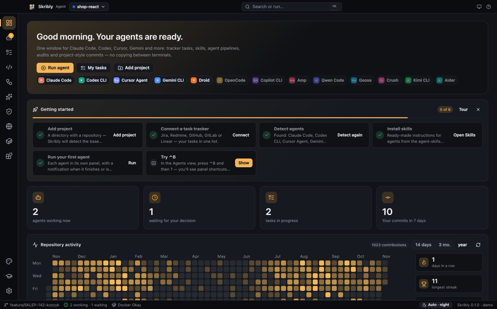
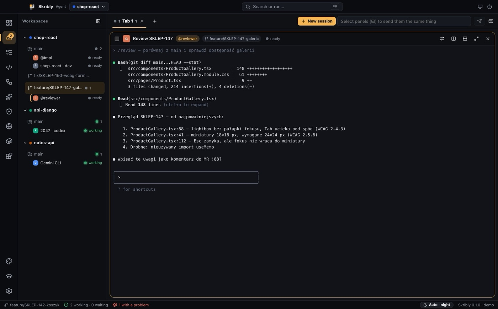
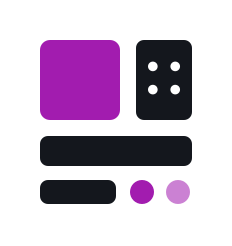

  

<strong>Ink and rubric.</strong> Tools for planning work and building software with AI agents — designed as one family.

  
  

---

## Why Skribly

Skribly is built by **Dawid Olko**, **[Piotr Smoła](https://github.com/PiotrSmola)**, **[Michał Pilecki](https://github.com/Prawy126)**, **[Konrad Pluta](https://github.com/g00staw)** and **[Mateusz Olko](https://github.com/OlkoMateusz)** — five developers from Rzeszów.

A medieval scribe — *skryba* in Polish, the word behind our name — copied texts by hand, in black ink, with red rubrics marking what mattered. That is the idea behind the brand: careful, readable work where the important things stand out. Everything under the Skribly name is built the same way — documented, accessible, tested, and meant to keep running after the demo.

Skribly is a private project I build with four friends. It is a family of developer tools for people who write software with AI coding agents. It is non-commercial: nothing is sold, it has no clients and offers no services, and its repositories stay private while we build. Three apps do the work — Skribly Tracker, Skribly Agent and agent-skills — and three shared pieces stand behind them: Skribly Core, Skribly UI and Skribly Docs. More pieces are being added, among them one sign-in for the apps and the templates every new app and site starts from.

## The family

### <picture><source media="(prefers-color-scheme: dark)" srcset="/img/skribly/tracker-mark-dark.svg"></picture> Skribly Tracker

The **issue tracker** of the family, built on **Node.js, TypeScript and PostgreSQL**: projects, issues with keys such as `SKR-12`, Kanban boards, comments and subtasks — in the browser and inside Skribly Agent. Its REST API has 53 operations, each checked by contract tests against the shared schemas of Skribly Core; it is described in OpenAPI and documented at [docs.skribly.pl](https://docs.skribly.pl). Row-level security in PostgreSQL keeps one organisation's data apart from another's, and the code is split into modules. It is the default tracker in Skribly Agent, and the agent-skills `task` skill supports it as one of six trackers, next to Redmine, Jira, GitHub, GitLab and Linear. The first edition ran on Laravel. The Tracker is in development: it is not deployed, and there is nothing public to try yet.

### <picture><source media="(prefers-color-scheme: dark)" srcset="/img/skribly/agent-mark-dark.svg"></picture> Skribly Agent

A **desktop app for AI coding agents** on macOS, Windows and Linux. Claude Code, Codex, Cursor Agent, Gemini CLI and more run side by side in workspaces, tabs and split panes — and the app shows which agent is working, which one waits for a decision and which one has finished. Its own site is live at **[agent.skribly.pl](https://agent.skribly.pl)**; the downloads there are in progress, so there is no installer to try yet.

- Agent states read from the live screen, notifications, sessions restored after a restart and one history of past sessions across agents
- Tasks from Skribly Tracker, Jira, Redmine, GitHub, GitLab and Linear — start one and an agent gets the branch, the task file and the prompt
- A git worktree per agent, pipelines of several agents, review notes written on a diff and sent to an agent, commit proposals without AI trailers
- Security, WCAG and SEO audits and a browser inside the app shared with agents
- A list of the MCP servers of every agent with a connection test, and import and export of your own data
- A `skribly` command and an MCP server that only reads by default and asks in the app before any change
- An inbox of the agents that wait for you, and a board of the tokens used per day, agent and project
- Light, dark and high-contrast themes from Skribly UI and the same accessibility switches as the Skribly sites

  

  

### <picture><source media="(prefers-color-scheme: dark)" srcset="/img/skribly/skills-mark-dark.svg"></picture> agent-skills

A library of **38 portable skills** — task workflow, commits, reviews, backend and end-to-end tests, PageSpeed, security and WCAG audits, migrations, Docker, CI, decision records and more — with **one installer for seven coding agents** (Claude Code, Codex, Cursor, Gemini CLI, OpenCode, GitHub Copilot, Devin). Each skill carries the fields of the open Agent Skills specification. The current version is 0.3.0.

- **Adapts to each project** through a project profile
- **Learns:** confirmed lessons are kept per project
- **Cheap on tokens:** tool output is condensed before an agent reads it — a 455 KB Lighthouse report becomes 754 bytes
- **Safe by default:** a risky step waits for your OK, and commits carry no AI trailers
- **Works anywhere:** it works in any repository; for now it is available to our team only

### <picture><source media="(prefers-color-scheme: dark)" srcset="/img/skribly/core-mark-dark.svg"></picture> Skribly Core

The **shared contracts** of the family and the **server kit** the apps are built on, written in TypeScript. The contracts are the Tracker API schemas and client, webhook signing and verification, a catalogue of events in the CloudEvents format and an app registry. The server kit gives each app database access that keeps every organisation's data apart, events, the HTTP layer, an MCP layer, seeds and test helpers; Skribly Tracker already runs on it. An independent review of the server kit in November 2026 found 19 problems, and all 19 are closed. Version 0.3.0 is out inside the project; Core is in development and not published as a package.

### <picture><source media="(prefers-color-scheme: dark)" srcset="/img/skribly/ui-mark-dark.svg"></picture> Skribly UI

The **design system**: design tokens, plain CSS classes that work on any page, 250 React components in 22 groups built on React Aria, the app shell the apps are laid out with, and the Astro site kit behind skribly.pl, docs.skribly.pl and ui.skribly.pl. It has light, dark and high-contrast themes and a brand section with the marks of the family, and it is built to WCAG 2.2 AA as a target. The live gallery is at **[ui.skribly.pl](https://ui.skribly.pl)**.

### <picture><source media="(prefers-color-scheme: dark)" srcset="/img/skribly/docs-mark-dark.svg"></picture> Skribly Docs

The **documentation** at **[docs.skribly.pl](https://docs.skribly.pl)**, in English and Polish: installing and using Skribly Agent, agent-skills and Skribly Tracker, the Tracker REST API reference, and the Core and UI packages. It documents only what exists and marks everything else as planned.

### <picture><source media="(prefers-color-scheme: dark)" srcset="/img/skribly/newsletter-mark-dark.svg"></picture> Skribly Newsletter

A free **daily digest of AI news for developers**, in Polish or English, at **[newsletter.skribly.pl](https://newsletter.skribly.pl)**. Every item comes with its source and there are no ads.

The sites of the family share one header, one page layout and one accessibility panel, and are in English and Polish where they have text to read.

## The public sites

| Address | What is there |
| --- | --- |
| [skribly.pl](https://skribly.pl) | The home of the project; the downloads lead to agent.skribly.pl |
| [agent.skribly.pl](https://agent.skribly.pl) | The site of Skribly Agent; the downloads are in progress |
| [docs.skribly.pl](https://docs.skribly.pl) | Documentation in English and Polish |
| [ui.skribly.pl](https://ui.skribly.pl) | The Skribly UI gallery and the brand marks |
| [newsletter.skribly.pl](https://newsletter.skribly.pl) | A daily AI digest for developers, in Polish or English |
| [projects.skribly.pl](https://projects.skribly.pl) | What each project of the team is, what it is made of and where it stands |
| [status.skribly.pl](https://status.skribly.pl) | The state of the public sites, checked on a schedule |
| [trust.skribly.pl](https://trust.skribly.pl) | Security reports, personal data, accessibility and licences |
| [tools.skribly.pl](https://tools.skribly.pl) | The tools that are live today, each with its status |
| [dc.skribly.pl](https://dc.skribly.pl) | Forwards to the Skribly Discord server |

## What is being added

These pieces are in development. Their addresses on skribly.pl (tracker, id, hub, api, time and feedback) show a placeholder page until each piece is ready.

- **Skribly ID** — one sign-in for the Skribly apps: an OpenID Provider with organisations and scoped tokens. Accounts, organisations and roles already run; the sign-in pages and the tokens are next.
- **Skribly API** — one address for the REST APIs of the apps, and later the gateway to their MCP servers.
- **Skribly Hub** — a local, read-only console that shows the state of every repository of the project: versions, decisions and checks.
- **Skribly Time** and **Skribly Feedback** — two more pieces with a reserved address; nothing to try yet.
- **App and site templates** — the starting point of every new Skribly app (Next.js on the server kit of Skribly Core) and every new site (Astro on the site kit of Skribly UI).

## How they fit together

  

A task comes from **Skribly Tracker** or another tracker such as Jira, Redmine or GitHub. **Skribly Agent** turns it into a branch, a task file and an agent session; the agents work with **agent-skills** for tests, audits, documentation and clean commits, and a person reviews the change before it is committed. **Skribly Core** holds the shared contracts and the server kit the Tracker runs on, **Skribly UI** the look of the apps and the sites, and **Skribly Docs** the explanations, and **Skribly Newsletter** brings a daily AI digest to your inbox. **Skribly ID** will give the apps one sign-in, and **Skribly API** one address for their APIs.

## Status

The website **[skribly.pl](https://skribly.pl)**, the site of the Agent **[agent.skribly.pl](https://agent.skribly.pl)**, the documentation **[docs.skribly.pl](https://docs.skribly.pl)**, the design system **[ui.skribly.pl](https://ui.skribly.pl)**, the newsletter **[newsletter.skribly.pl](https://newsletter.skribly.pl)** and the sites listed above are public. Everything else is in development: Skribly Tracker is not deployed, the downloads of Skribly Agent are in progress, and the pieces being added show a placeholder page. The repositories are private while we build. Questions go to **contact@dawidolko.pl**.

<a href="/">← Back to the profile</a>

