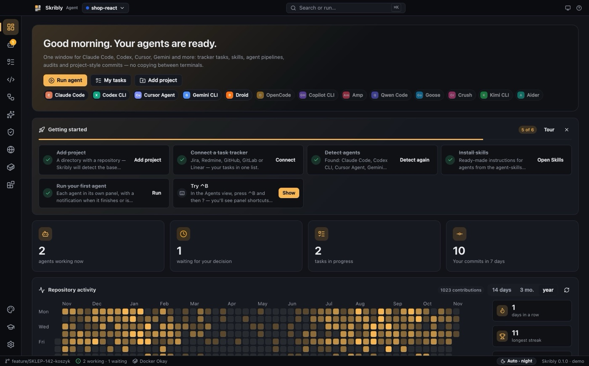
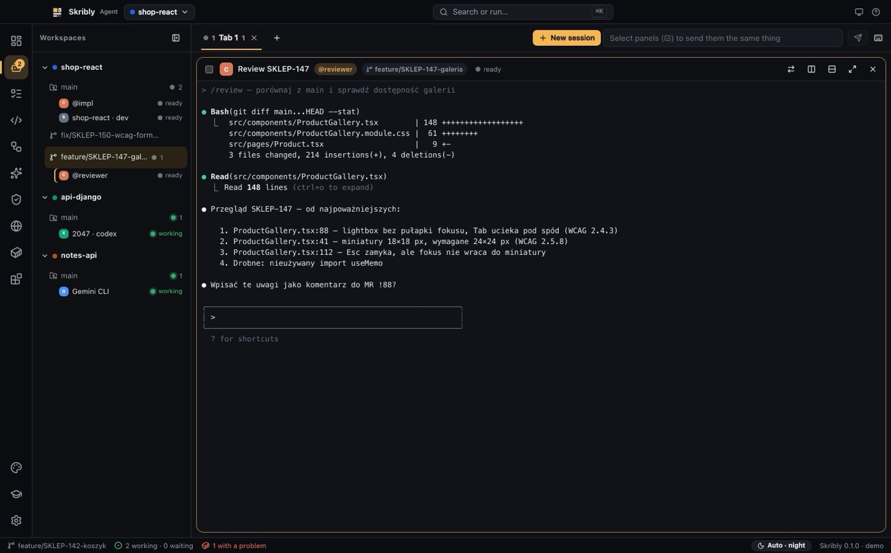

  

<strong>Ink and rubric.</strong> Tools for planning work and building software with AI agents — designed as one family.

  
  

---

## Why Skribly

Skribly is built by **Dawid Olko**, **[Piotr Smoła](https://github.com/PiotrSmola)**, **[Michał Pilecki](https://github.com/Prawy126)**, **[Konrad Pluta](https://github.com/g00staw)** and **[Mateusz Olko](https://github.com/OlkoMateusz)** — five developers from Rzeszów.

A medieval scribe — *skryba* in Polish, the word behind our name — copied texts by hand, in black ink, with red rubrics marking what mattered. That is the idea behind the brand: careful, readable work where the important things stand out. Everything under the Skribly name is built the same way — documented, accessible, tested, and meant to keep running after the demo.

We are building Skribly as our own ecosystem: products we use every day, shaped into something other developers and teams can use too. Three apps do the work — a tracker, a desktop app for coding agents and a library of skills — and three shared pieces hold them together: Skribly Core, Skribly UI and the documentation.

## The family

###  Skribly Tracker

The **issue tracker** of the ecosystem, in active development: projects, issues with keys like `SKR-12`, Kanban boards, comments, time logs and subtasks — in the browser and inside Skribly Agent. Built on Laravel 12, with a REST API that Skribly Agent and the agent-skills `task` skill use as their default tracker. The API is described in OpenAPI and documented at [docs.skribly.pl](https://docs.skribly.pl).

###  Skribly Agent

A **desktop IDE for AI coding agents** for macOS, Windows and Linux. Claude Code, Codex, Cursor Agent, Gemini CLI and more work side by side in workspaces, tabs and split panes — and the app knows which agent is working, which one waits for a decision and which one has finished.

- Agent states detected from the live screen, notifications for what you are not looking at, sessions restored after a restart
- Tasks from Jira, Redmine, GitHub, GitLab and Linear — start one and an agent gets the branch, the task file and the prompt
- Git worktrees per agent, multi-agent pipelines, commit proposals without AI trailers
- Security, WCAG and SEO audits, an in-app browser shared with agents, Claude and Cursor integrations, Docker monitoring
- A `skribly` CLI and MCP server, so one agent can start, prompt and read another
- Installers for every system and automatic updates

  

  

###  agent-skills

A library of **29 portable skills** — task workflow, commits, reviews, backend and end-to-end tests, PageSpeed, security and WCAG audits, migrations, Docker, CI and more — with **one installer for seven agents** (Claude Code, Codex, Cursor, Gemini CLI, OpenCode, Windsurf, GitHub Copilot).

- **Adapts to each project:** the `project` skill detects the stack, the commands and the commit convention into a project profile that every other skill reads first
- **Learns:** confirmed lessons are kept per project, so the skills get better at a repository over time
- **Cheap on tokens:** scripts condense tool output before an agent reads it — a 455 KB Lighthouse report becomes 754 bytes
- **Safe by default:** every risky step waits for your OK, and commits carry no AI trailers

###  Skribly Core

The **shared contracts** of the ecosystem, written in TypeScript: identity and scopes, a catalogue of events in the CloudEvents format, the registry of apps and signed webhooks. Every app builds on the same definitions, so the pieces fit together instead of each inventing its own.

###  Skribly UI

The **design system**: one set of design tokens, plain CSS classes that work on any page, and React components built on React Aria for the apps. It is built to WCAG 2.2 AA as a target, with light, dark and high-contrast themes. The live gallery is at **[ui.skribly.pl](https://ui.skribly.pl)**.

###  Skribly Docs

The **public documentation** at **[docs.skribly.pl](https://docs.skribly.pl)**: installing and using Skribly Agent, agent-skills and Skribly Tracker, the Tracker REST API reference, and the Core and UI packages. It documents only what exists and marks everything else as planned.

## How they fit together

  

A task arrives from **Skribly Tracker** or another tracker such as Jira, Redmine or GitHub. **Skribly Agent** turns it into a branch, a task file and an agent session; the agents work with **agent-skills** for tests, audits, documentation and clean commits. Underneath, **Skribly Core** gives the apps one shared vocabulary of identities, events and webhooks, **Skribly UI** gives them one look, and **Skribly Docs** explains all of it in one place. agent-skills stays independent — any developer can install it in any repository, with or without the rest of Skribly.

## Status

The website is **[skribly.pl](https://skribly.pl)**, the documentation is **[docs.skribly.pl](https://docs.skribly.pl)** and the design system is **[ui.skribly.pl](https://ui.skribly.pl)**. All Skribly repositories live in the **private skribly organisation on GitHub for now** — we build them every day and will open them step by step. If you want early access or a demo, write to **contact@dawidolko.pl** or reach me on [LinkedIn](https://www.linkedin.com/in/dawidolko/).

<a href="/">← Back to the profile</a>

